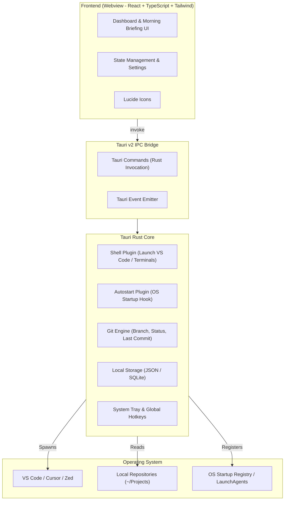
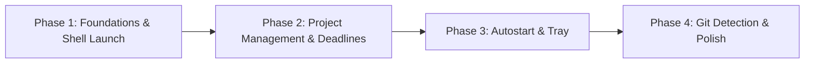

# Development Hub (DevHub) — Architecture & Product Specification

> [!NOTE]
> **DevHub** is a lightweight, cross-platform desktop application designed to eliminate developer context switching, prevent project sprawl, and ensure deadlines are never missed. It greets the developer when their laptop boots with a prioritized morning briefing and instant one-click project launching.

---

## 1. Executive Summary & Goals

| Attribute | Specification |
| :--- | :--- |
| **Primary Goal** | Single pane of glass for active developer projects, deadlines, and one-click IDE launch. |
| **Target Platforms** | Windows 10/11, macOS (Intel & Apple Silicon), Linux (Ubuntu/Debian/Fedora). |
| **Core Architecture** | Tauri v2 (Rust runtime + OS Native Webview) with React + TypeScript + Tailwind CSS. |
| **Primary Metric** | Zero-lag startup (< 500ms cold start), low idle memory footprint (< 60MB RAM). |

---

## 2. System Architecture



---

## 3. Core Feature Specifications

### 3.1. Morning Briefing & Dashboard
- **Wake-up Trigger**: Launches automatically on system login (via `tauri-plugin-autostart`).
- **Priority Quadrants**:
  1. **Needs Attention / Urgent**: Projects with deadlines within 72 hours or open blockers.
  2. **In Progress (Active Streak)**: Projects committed to within the last 48 hours.
  3. **Stale / Forgotten**: Projects inactive for > 7 days with uncommitted work or open issues.
- **Project Cards**:
  - Project Title & Category tag (e.g. `Client`, `Work`, `Personal`).
  - Active Git Branch name & dirty working tree badge (e.g. `feature/auth-flow` • `3 files modified`).
  - Deadline countdown pill (e.g. `Due in 2 days` with color escalation: Green → Amber → Red).
  - Quick action buttons: **Open in VS Code**, **Open Terminal**, **View on GitHub**.

### 3.2. One-Click Launcher Engine
- **Primary IDE**: Launches VS Code at the project directory (`code <path>`).
- **Configurable Fallbacks**: Support for Cursor (`cursor <path>`), Zed (`zed <path>`), JetBrains (`idea <path>`), or Sublime Text.
- **Terminal Launch**: Spawns terminal at project path (PowerShell / Windows Terminal on Windows; Terminal / iTerm2 on macOS; default shell on Linux).
- **Environment Bootstrapping (Optional)**: One-click script runner (e.g., auto-runs `npm run dev` or `docker compose up`).

### 3.3. Git Integration (Zero Manual Effort)
- Built directly into the Rust backend for blazing fast read performance.
- Direct read of `.git/HEAD`, `.git/refs/heads`, and commit log.
- Highlights:
  - Branch name.
  - Time since last commit.
  - Count of uncommitted/staged files.

### 3.4. System Tray & Quick Switcher
- DevHub can minimize to the system tray rather than closing completely.
- A global hotkey (e.g., `Alt + Space` or `Alt + D`) summons a Spotlight/Raycast-style search bar for fast project switching throughout the day.

---

## 4. Data Models & Local Storage

All data stays strictly local on the developer's machine in an application data directory (`%APPDATA%/devhub` or `~/.config/devhub`).

### `Project` Schema
```typescript
interface Project {
  id: string;                    // UUID
  name: string;                  // Display name
  path: string;                  // Absolute filesystem path
  category: "work" | "personal" | "client" | "open-source";
  deadline?: string;             // ISO 8601 date string
  priority: "low" | "medium" | "high" | "critical";
  favorite: boolean;
  notes?: string;                // Short markdown notes / TODOs
  gitStatus?: {
    branch: string;
    uncommittedCount: number;
    lastCommitTime: string;
    lastCommitMessage: string;
  };
  lastOpenedAt?: string;
  createdAt: string;
}
```

### `UserSettings` Schema
```typescript
interface UserSettings {
  autostartOnLogin: boolean;
  minimizeToTray: boolean;
  preferredIde: "vscode" | "cursor" | "zed" | "webstorm" | "custom";
  customIdeCommand?: string;
  defaultTerminal: "system" | "powershell" | "cmd" | "iterm2" | "bash";
  autoScanDirectories: string[]; // e.g. ["C:\\Projects", "D:\\Repos"]
  theme: "dark" | "light" | "system";
}
```

---

## 5. UI Layout Design

```
+-----------------------------------------------------------------------------------+
|  [⚡ DevHub]   Search projects... (Ctrl+K)              [+ Add Project] [⚙ Settings] |
+-----------------------------------------------------------------------------------+
|  🌅 MORNING BRIEFING                                                               |
|  Good morning! You have 2 projects needing attention today.                        |
|                                                                                   |
|  [ ⚠️ Client Portal API ]               [ ⏳ Portfolio Redesign ]                 |
|  Due in: 18 hours (Tomorrow)            Due in: 3 days                             |
|  Branch: fix/payment-webhook            Branch: main                               |
|  Uncommitted: 2 files                   Clean tree                                 |
|  [🚀 Open in VS Code] [📂 Dir]          [🚀 Open in VS Code] [📂 Dir]              |
+-----------------------------------------------------------------------------------+
|  📁 ALL ACTIVE PROJECTS (Filtered: All | Work | Client | Personal)                 |
|                                                                                   |
|  +------------------------------------------------------------------------------+ |
|  | ⭐ E-Commerce Microservices         Path: D:\Projects\ecommerce              | |
|  | Branch: dev  •  Last commit: 2 hrs ago                                       | |
|  | [🚀 Open VS Code]  [💻 Terminal]  [🌐 GitHub]  [⋯ Actions]                   | |
|  +------------------------------------------------------------------------------+ |
|  | 💤 Abandoned Mobile App             Path: D:\Projects\react-native-gym       | |
|  | Untouched for: 14 days  •  Status: Stale                                     | |
|  | [🚀 Open VS Code]  [💻 Terminal]  [⋯ Actions]                                | |
|  +------------------------------------------------------------------------------+ |
+-----------------------------------------------------------------------------------+
```

---

## 6. Phased Implementation Roadmap



### Phase 1: Foundations & Core Launcher
- Initialize Tauri v2 with React, TypeScript, Tailwind CSS, and Lucide Icons.
- Implement Tauri Rust command `open_in_ide(path, ide)` using `std::process::Command` / `tauri-plugin-shell`.
- Build the core project list view with launch triggers.

### Phase 2: Project Persistence & Deadlines
- Implement local JSON storage for user projects and preferences.
- Directory folder picker (`tauri-plugin-dialog`) to easily select repository paths.
- Add deadline picker and countdown calculator (color-coded urgency tags).

### Phase 3: Autostart & System Tray Integration
- Configure `tauri-plugin-autostart` with a toggle in the settings view.
- Setup native system tray with quick-launch items and "Minimize on Close".

### Phase 4: Git Status Detection & Smart Briefing
- Rust command to inspect the `.git` folder for branch name, commit timestamps, and status.
- Build the "Morning Briefing" top section highlighting urgent and stale repositories.

---

> [!IMPORTANT]
> **Prerequisites for local development on Windows**:
> - Node.js (v18+)
> - Rust toolchain (`rustup` / `cargo`)
> - Microsoft Visual Studio C++ Build Tools (required by Tauri on Windows)
